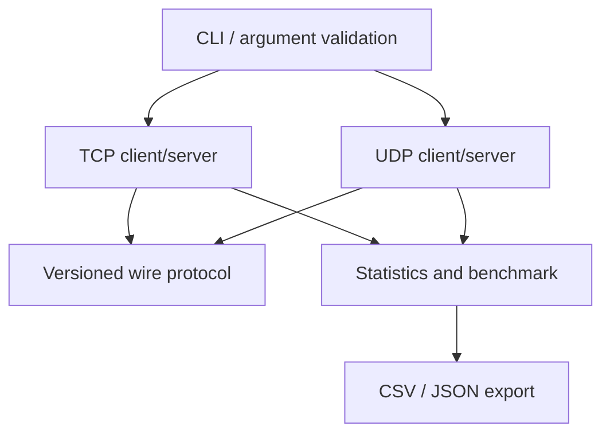

# Architecture

The CLI validates arguments and dispatches to the socket implementation. TCP uses a listener plus a managed thread per accepted client. Each worker reads exactly one 24-byte header and then the validated payload length, which preserves framing even when TCP splits or coalesces writes. UDP receives one datagram at a time, validates the complete datagram, and echoes a response to its sender. Protocol encoding is independent from sockets. Statistics are accumulated per benchmark invocation and exported at completion.

The server defaults to `127.0.0.1`. SIGINT/SIGTERM set an atomic stop flag; poll loops check it regularly. TCP workers are joinable and joined during shutdown. This is a compact learning implementation; the TCP worker vector is retained until shutdown, so very long-lived high-churn deployments would benefit from a bounded worker pool/reaping strategy.
